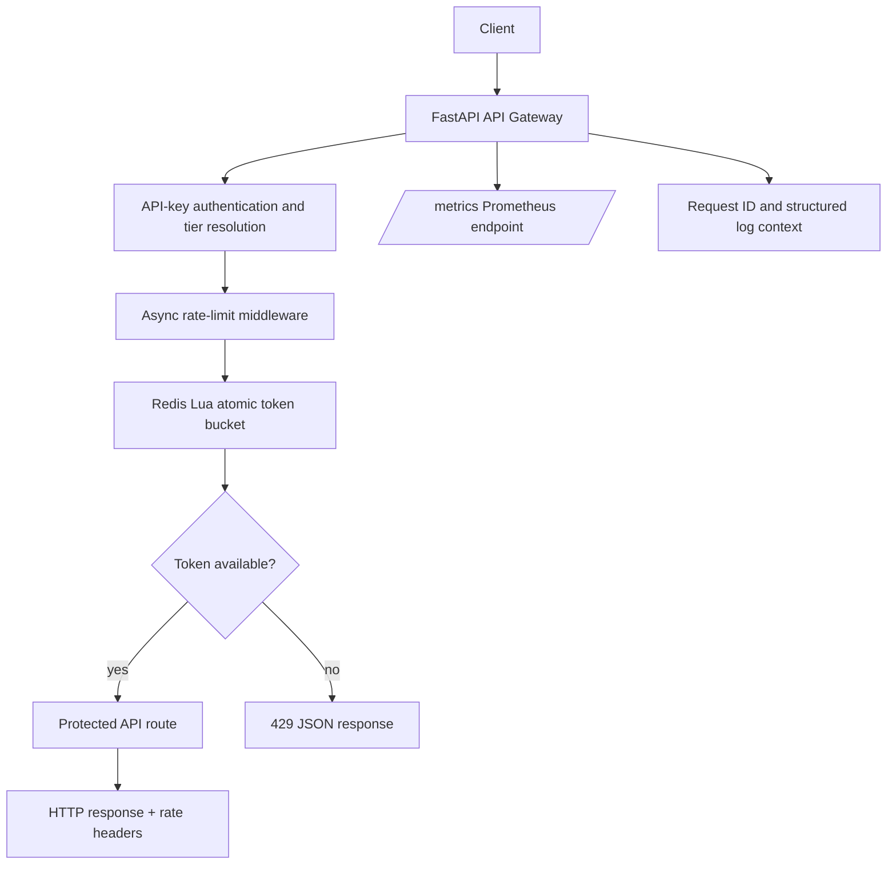

# Distributed Rate Limiter & API Gateway

A small, interview-ready FastAPI gateway that enforces configurable per-client
token-bucket limits across multiple processes using Redis and an atomic Lua
script. It keeps a thread-safe in-memory implementation as a reference and
test double, but the distributed path is the primary design.

## Why rate limiting matters

Rate limiting protects downstream services from accidental overload, abusive
clients, and noisy neighbors. A token bucket allows a controlled burst while
enforcing a continuous long-term rate, which is usually a better API contract
than a fixed counter window.

## Architecture



Every gateway instance uses the same Redis bucket namespace. The Lua script
performs read, refill, consume, and write in one Redis operation, so concurrent
requests cannot both consume the same token. Idle buckets expire after enough
time to refill, limiting stale key growth.

## Token bucket and tiers

Each bucket has `capacity` tokens and refills continuously at
`refill_rate` tokens/second. A request costs one token. New buckets start full;
tokens never exceed capacity or become negative. The default development tiers
are:

| Tier | Capacity | Refill rate |
| --- | ---: | ---: |
| free | 5 | 1/sec |
| premium | 50 | 10/sec |
| admin | 100 | 25/sec |

Limits and API-key-to-tier mappings are centralized in environment-backed
configuration. API keys are not returned or logged, and only a truncated SHA-256
identifier is used in Redis keys.

## API

Public operational endpoints:

- `GET /health` — process health; does not require Redis.
- `GET /ready` — readiness; returns `503` when Redis cannot be reached.
- `GET /metrics` — Prometheus exposition format.
- `GET /stats` — local, non-secret dashboard counters.

Protected endpoints require `X-API-Key`:

- `GET /api/ping`
- `GET /api/data`
- `GET /api/status`
- `GET /api/limits`

Example:

```bash
curl -H "X-API-Key: free-key-123" http://localhost:8000/api/ping
```

Allowed responses include `X-Request-ID`, `X-RateLimit-Limit`,
`X-RateLimit-Remaining`, and `X-RateLimit-Reset`. `X-RateLimit-Reset` is a
Unix timestamp for the next token availability. Rejected requests return `429`,
JSON with a request ID, `Retry-After` in seconds, and the same rate headers.
Missing or invalid keys return `401`. Redis failure defaults to fail-closed with
`503`; set `REDIS_FAILURE_MODE=open` only when that trade-off is intentional.

## Run with Docker

```bash
git clone https://github.com/harikamasam/distributed-rate-limiter-gateway.git
cd distributed-rate-limiter-gateway
copy .env.example .env        # Windows
# cp .env.example .env       # macOS/Linux
docker compose up --build
```

The gateway is available at `http://localhost:8000`. The standalone dashboard
is `dashboard/index.html`; it shows aggregate tier counters and never displays
API keys.

## Run locally

Start Redis separately, create a virtual environment, and install dependencies:

```bash
python -m venv .venv
.venv\Scripts\activate       # Windows; use source .venv/bin/activate on Unix
python -m pip install -r requirements.txt
copy .env.example .env
set REDIS_URL=redis://localhost:6379/0   # Windows; export on macOS/Linux
uvicorn app.main:app --reload
```

Important variables are documented in `.env.example`: `REDIS_URL`, timeout
values, `REDIS_FAILURE_MODE`, `CORS_ORIGINS`, `API_KEYS`, and per-tier limits.
The example keys are for local development only; use secret values elsewhere.

## Testing

Unit tests use an injectable clock and cover capacity, refill, isolation,
thread safety, and invalid configuration:

```bash
python -m pytest tests/test_token_bucket.py tests/test_config.py -q
```

Redis integration tests use database 15 and cover Lua atomic consumption,
refill, client isolation, two application instances sharing state, API auth,
429 headers, and readiness. They are skipped when Redis is not listening:

```bash
python -m pytest tests/test_redis_integration.py -q
```

CI starts Redis as a GitHub Actions service and runs lint plus the complete
suite. Locally, `docker compose up -d redis` is sufficient when Docker Desktop
is running.

## Benchmarking

The benchmark records measured JSON for concurrency 1, 10, 50, and 100 and
reports requests/sec, allowed/rejected requests, average, median, p95, and p99
latency. It can compare the local reference implementation and Redis:

```bash
python benchmark.py --mode all --requests 1000
```

Results are written to `benchmarks/results/latest.json`, which is ignored by
Git. No benchmark numbers are included here because results depend on CPU,
Python, Redis, operating system, network, configuration, and concurrency. Do
not present a result from one environment as a general production-throughput
claim.

## Project structure

```text
app/
  config.py              validated environment and tier settings
  main.py                FastAPI factory, middleware, routes, lifecycle
  metrics.py             Prometheus metrics
  redis_token_bucket.py  async Redis + atomic Lua implementation
  token_bucket.py        thread-safe process-local reference implementation
tests/
  test_token_bucket.py
  test_config.py
  test_redis_integration.py
dashboard/index.html
benchmark.py
Dockerfile
docker-compose.yml
.github/workflows/ci.yml
```

## Trade-offs and limitations

- In-memory state is local to one process and is not a distributed solution.
- Redis adds a network round trip; the Lua script improves correctness, not
  latency versus local memory.
- API keys are intentionally simple demo credentials, not a full identity
  provider or key-rotation system.
- `/stats` and the Prometheus counters are process-local. Deployments needing
  global analytics should aggregate metrics externally.
- Redis fail-open can preserve availability but may permit excess traffic;
  fail-closed is the safe default.
- There is no claim of production readiness without deployment-specific load,
  failure, security, and capacity testing.

## Future improvements

Key rotation backed by an identity service, Redis Sentinel/Cluster strategy,
distributed metrics aggregation, and a load-balancer test with two live gateway
processes are natural next steps. They are deliberately not added as extra
infrastructure to this focused project.
